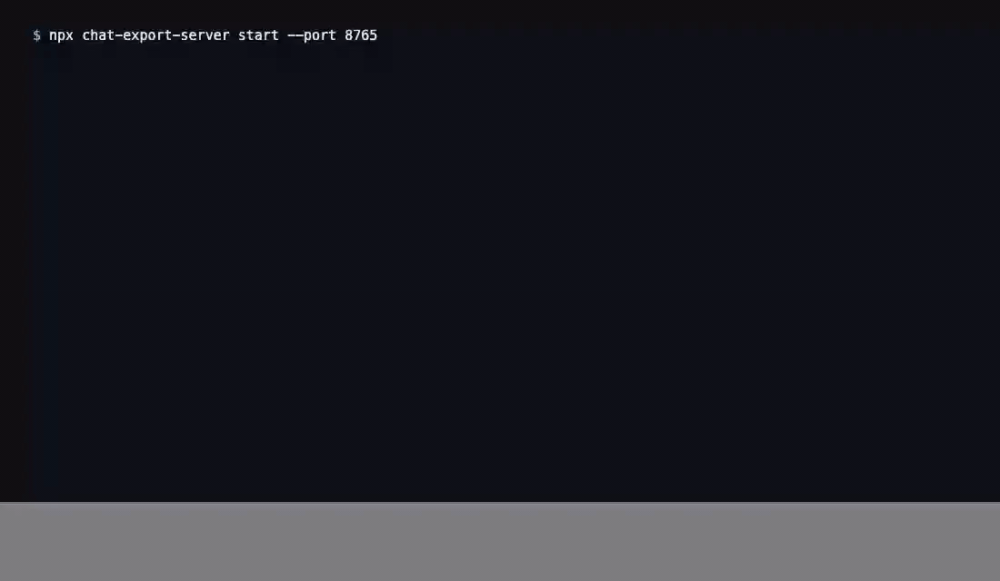

[English](README.md) | [Русский](README.ru.md) · [](https://www.donationalerts.com/r/svwergio_mel) · [](https://glama.ai/mcp/servers/svergio/chat-export-server) · [](https://mcpservers.org/ru/) · [](https://mcprush.com/to/chat-export-mcp?ref=badge)

# chat-export-server

<p align="center">
  
</p>

**Local MCP server** for the [Chat Export](https://github.com/svergio/chat-export-extension) Chrome extension. List, read, export, create, delete, and **ask** in your own chats on **eleven** web providers (ChatGPT, Grok, X Grok, Claude, GitHub Copilot, Qwen, DeepSeek, Perplexity, Kimi, Z.ai, MiniMax) — through the extension in **your** browser. (**JanitorAI** is extension export-bar only and is not in the MCP protocol.) Everything stays on `127.0.0.1`: job queues, SQLite chat cache, audit log, optional [dashboard](https://github.com/svergio/chat-export-dashboard) UI.

Listed on [Glama](https://glama.ai/mcp/servers/svergio/chat-export-server) (v1.0.8, Kimi / Z.ai / MiniMax MCP). Listed on [Mcprush](https://mcprush.com/svergio/chat-export-mcp).

## Standalone

`chat-export-server` plus the [Chrome extension](https://github.com/svergio/chat-export-extension) is a complete local stack. Browser chat ops run through the extension WebSocket bridge — **no** Chrome DevTools MCP, Playwright, or vendored agent code. Ship with **native** install, **Docker / Colima**, or **Kubernetes** (`deploy/k8s`). Any MCP client (Cursor, Claude Desktop, Open WebUI, local LLMs such as Bonsai-27B) is **optional**.

## Why this MCP (for awesome-list reviewers)

Most LLM MCP servers wrap a **vendor HTTP API** (keys, quotas, cloud data path). Chat Export is different: the agent talks MCP to a **local** process; that process drives the **web UIs you are already logged into** via the Chrome extension bridge. No OpenAI/Anthropic/xAI API keys for chat ops, no chat bodies leaving `127.0.0.1`, and delete/create stay off until you opt in (`allowDestructive` + `confirm`). Pair with the [extension zip](https://github.com/svergio/chat-export-extension/releases/tag/v2.0.9); point Cursor (or any MCP client) at `http://127.0.0.1:8765/mcp`.

## The problem

IDE agents need **structured access** to web LLM sessions without pasting cookies or paying per-token cloud APIs. You want MCP tools, retries, and queues — but data must not leave your machine.

## What you get

| Platform | Automation |
|----------|------------|
| ChatGPT | list / get / export / create / delete / ask |
| Grok (`grok.com`) | same |
| X Grok | same |
| Claude | same |
| GitHub Copilot web | same |
| Qwen (`chat.qwen.ai`) | same |
| DeepSeek (`chat.deepseek.com`) | same |
| Perplexity (`perplexity.ai`) | same |
| Kimi (`kimi.com`) | same |
| Z.ai (`chat.z.ai`) | same |
| MiniMax (`agent.minimax.io`) | same |

## Architecture

`chat-export-server` binds on loopback (by default), hosts the extension **browser hub** over WebSocket (`/ws`, `ceb_` tokens), exposes **Streamable HTTP MCP** at `/mcp` for IDE agents (`cem_`/`cek_`), runs **per-browser job lanes** with a SQLite chat cache and WAL, and optionally serves the embedded **dashboard** at `/dashboard/` plus `/dashboard/api`. Long operations (`chat_ask`, bulk export, delete with gates) go through the job queue instead of blocking MCP.

Install paths: **native** Node 22 CLI (`npm run build`, `chat-export-server start`), **Docker / Colima** (`Dockerfile` + Compose on `127.0.0.1:8765`), or **Kubernetes** (`kubectl apply -k deploy/k8s`, port-forward for the Chrome bridge). Full **Mermaid diagrams** and endpoint map: **[Wiki — Architecture](https://github.com/svergio/chat-export-extension/wiki/Architecture)**. Operators: [Native and Kubernetes deployment](https://github.com/svergio/chat-export-extension/wiki/Native-and-Kubernetes-Deployment) · [Use cases](https://github.com/svergio/chat-export-extension/wiki/Use-Cases) · [MCP tools and profiles](https://github.com/svergio/chat-export-extension/wiki/MCP-Tools-and-Profiles).

## Quick start (3 steps)

1. **Extension** — load [chat-export-extension](https://github.com/svergio/chat-export-extension) unpacked; enable bridge in popup; open provider tabs logged in.
2. **Server** — `npm install && npm run build`, `chat-export-server key new`, `chat-export-server start` → `http://127.0.0.1:8765`.
3. **MCP client** — point to `http://127.0.0.1:8765/mcp` with `Authorization: Bearer <key>`; run `browsers_bind` then `chats_list` / `chats_export` / `chat_ask`.

Wiki: [MCP tools and profiles](https://github.com/svergio/chat-export-extension/wiki).

## Install and build

```sh
npm install
npm run build   # tsc -> dist/
npm link        # optional: chat-export-server on PATH
```

Requires **Node 22.13+** (`node:sqlite`).

| Script | Purpose |
| --- | --- |
| `npm run build` | compile to `dist/` |
| `npm run typecheck` | `tsc --noEmit` |
| `npm start` | `node dist/cli/index.js start` |
| `npm run dev` | `tsx watch src/cli/index.ts start` |
| `npm run mcp` | stdio MCP attached |

### First run

```sh
chat-export-server key new    # print once; hash stored
chat-export-server start
# WS   /ws, /ext  — extension bridge
# MCP  /mcp       — Bearer key
# GET  /health
```

Data under `~/.chat-export` (override `CHAT_EXPORT_HOME`):

```text
~/.chat-export/
  config.json    # host, port, exportDir
  keys.json      # hashes only (chmod 600)
  audit.log      # MCP/RPC audit
  exports/       # chats_export output
```

```sh
chat-export-server key rotate
chat-export-server key list
chat-export-server status
```

## Configuration

### Environment variables

Copy [`.env.example`](.env.example) to `.env` in the server directory (or set `CHAT_EXPORT_ENV_FILE`), then `chmod 600 .env`. Never commit `.env` (gitignored); keep secrets out of `.env.example`. Container and process env override `config.json` where noted.

| Variable | Purpose |
|----------|---------|
| `CHAT_EXPORT_HOME` | Data directory (default `~/.chat-export`; `/data` in Docker) |
| `CHAT_EXPORT_HOST` | Bind address (`127.0.0.1` locally; use `0.0.0.0` in containers) |
| `CHAT_EXPORT_PORT` | HTTP port (default `8765`) |
| `CHAT_EXPORT_ALLOWED_HOSTS` | Extra `Host` header names allowed (comma-separated) |
| `CHAT_EXPORT_DASHBOARD_ENABLED` | `true` / `false` |
| `CHAT_EXPORT_ADMIN_USER` / `CHAT_EXPORT_ADMIN_PASS` | Dashboard login (overrides `config.json`) |
| `CHAT_EXPORT_MCP_TOKEN` | Optional preset `cem_…` token hash on start |
| `CHAT_EXPORT_BROWSER_TOKENS` | `browserId:ceb_…[:label]` comma list for auto-enroll |
| `CHAT_EXPORT_ALLOW_DESTRUCTIVE` | `true` / `false` |
| `CHAT_EXPORT_DB_DRIVER` | DB driver override (`sqlite` default) |
| `CHAT_EXPORT_DB_URL` | DB URL when not using default SQLite path |
| `CHAT_EXPORT_SKIP_MCP_CONFIG` | Set `1` to skip auto-writing Cursor MCP config on `key new` |

### Docker and Colima

This repo ships a **multi-stage** [`Dockerfile`](Dockerfile) (Node 22 Alpine, non-root user, `CHAT_EXPORT_HOME=/data`, listen `0.0.0.0:8765`, `/health` check). **Docker Desktop is not required** — use [Colima](https://github.com/abiosoft/colima) on macOS:

```sh
colima start
docker context use colima   # or: docker --context colima …
cp .env.example .env        # set CHAT_EXPORT_ADMIN_PASS at minimum
docker --context colima compose build
docker --context colima compose up -d
curl -sS http://127.0.0.1:8765/health
```

Published only on **`127.0.0.1:8765`**. Persistent data: Compose volume `chat-export-data` → `/data`.

Stop when finished so a local `chat-export-server` daemon can reclaim the port:

```sh
docker --context colima compose down
```

Optional **split stack** (nginx serves dashboard static, proxies `/dashboard/api`, `/mcp`, `/ws`, `/ext`, `/enroll`, `/health` to the server): build from the maintainer tree `chat-export-dashboard/Dockerfile` and `projects/Chat Export/docker-compose.yml` (see [dashboard repo](https://github.com/svergio/chat-export-dashboard)).

### Kubernetes

Manifests under [`deploy/k8s/`](deploy/k8s/) (non-root UID `10001`, PVC on `/data`, `/health` probes, Ingress with WebSocket upgrade for `/ws`, `/ext`, `/mcp`). Apply with `kubectl apply -k deploy/k8s`; for local Chrome bridge use `kubectl port-forward` to `127.0.0.1`. Full steps: [deploy/k8s/README.md](deploy/k8s/README.md) and wiki [Native and Kubernetes deployment](https://github.com/svergio/chat-export-extension/wiki/Native-and-Kubernetes-Deployment).

### `config.json` (under `CHAT_EXPORT_HOME`)

Created on first start. Example (secrets redacted):

```json
{
  "host": "127.0.0.1",
  "port": 8765,
  "exportDir": "~/.chat-export/exports",
  "rpcTimeoutMs": 60000,
  "dashboard": {
    "enabled": true,
    "username": "admin",
    "password": "changeme"
  },
  "registeredBrowsers": [],
  "settings": {
    "platformsEnabled": ["chatgpt", "grok", "grok-x", "copilot", "claude"],
    "allowDestructive": false,
    "exportSchema": "chat-export/1"
  }
}
```

`settings.exportSchema` defaults to `chat-export/1` (also `sharegpt/1`). MCP `chats_export` / export jobs accept optional `schema`; omitted → this setting, then the browser default. See wiki [Export formats](https://github.com/svergio/chat-export-extension/wiki/Export-Formats).

Change **`dashboard.password`** before exposing the host beyond loopback. Server listens on **`127.0.0.1:8765`** by default (`/health`, `/mcp`, `/ws`, `/dashboard/`).

### Tokens

| Prefix | Used by |
|--------|---------|
| `cek_` / `cem_` | MCP and CLI (`Authorization: Bearer …` on `/mcp`) |
| `ceb_` | Chrome extension WebSocket (`/ws`); enroll via CLI or [dashboard](https://github.com/svergio/chat-export-dashboard) |

Only **hashes** of MCP keys are stored in `keys.json` (mode `600`). Plaintext is shown once at `chat-export-server key new`.

### Detached daemon (maintainer workspace)

In the Chat Export maintainer tree, `tmp-scripts/ensure-daemon.mjs` can keep `chat-export-server` running on `:8765`, write `~/.chat-export/server.pid`, and optionally sync `Bearer cem_…` into `.cursor/mcp.json` (`--sync-mcp-json`). Equivalent manual start: `chat-export-server start`.

### Cursor MCP (`~/.cursor/mcp.json` or project `.cursor/mcp.json`)

HTTP (server already running):

```json
{
  "mcpServers": {
    "chat-export": {
      "url": "http://127.0.0.1:8765/mcp",
      "headers": {
        "Authorization": "Bearer cem_YOUR_KEY_HERE"
      }
    }
  }
}
```

**Profiles:** expose the full tool surface (`chats_*`, `jobs_*`, `chat_cache_*`, `projects_*`) for IDE agents. A **small** read-focused subset (list/get/export, browsers, platforms) is documented on the [wiki MCP tools page](https://github.com/svergio/chat-export-extension/wiki/MCP-Tools-and-Profiles) — match your client’s token budget. Open WebUI via **mcpo** can proxy the same HTTP endpoint if your setup uses an OpenAPI bridge on another port.

After MCP is configured, run **`browsers_bind`** so tools target your connected Chrome profile.

Extension bridge settings: [chat-export-extension README](https://github.com/svergio/chat-export-extension#configuration).

## Background jobs

Long work (`chat_ask`, export, bulk delete) uses per-browser lanes:

- `jobs_enqueue`, `jobs_status`, `jobs_list`, `jobs_cancel`

## Cursor MCP config

HTTP (server already running):

```json
{
  "mcpServers": {
    "chat-export": {
      "url": "http://127.0.0.1:8765/mcp",
      "headers": {
        "Authorization": "Bearer cek_YOUR_KEY_HERE"
      }
    }
  }
}
```

stdio:

```json
{
  "mcpServers": {
    "chat-export": {
      "command": "chat-export-server",
      "args": ["start", "--stdio"],
      "env": {
        "CHAT_EXPORT_HOME": "/Users/YOU/.chat-export"
      }
    }
  }
}
```

## MCP tools (overview)

| Tool | Purpose |
| --- | --- |
| `browsers_list` / `browsers_bind` / `browsers_status` | Connected Chrome profiles |
| `platforms_list` | Enablement matrix |
| `platforms_status` / `platforms_capabilities` | Gate probe (incl. `captcha`) / composer caps |
| `chats_list` / `chats_get` / `chats_export` | Read and write exports |
| `chats_create` / `chats_send` / `chats_delete` | UI drive (`onCaptcha`; delete needs `confirm: true`) |
| `chat_ask` | Send prompt; wait or job queue |
| `projects_list` / `projects_*` | Projects/folders (use `projects_list`; MCP alias `containers_list` removed) |
| `jobs_*` | Async pipeline |
| `chat_cache_*` | Temp SQLite cache for long threads |

Full list evolves with releases; see wiki **MCP Tools**. Captcha is never auto-solved.

## Optional: local LLM (e.g. Bonsai-27B)

Any **external** MCP client (Cursor, Claude Desktop, Open WebUI, or your own agent) can call Streamable HTTP at `http://127.0.0.1:8765/mcp`. A local OpenAI-compatible runtime such as **Bonsai-27B** (oMLX or similar on `:8000/v1`) is an optional orchestrator — Chat Export does **not** ship or vendor agent code. Example pattern: local model plans steps, this server drives `chat_ask` / `jobs_*` in your logged-in Chrome tabs. Guide: wiki [Local LLM + Bonsai-27B](https://github.com/svergio/chat-export-extension/wiki/Local-LLM-Bonsai-27B-Guide) ([RU](https://github.com/svergio/chat-export-extension/wiki/Local-LLM-Bonsai-27B-Guide-RU)).

## Layout

```text
packages/protocol/   wire contract v1
src/core/            config, keys, audit, db, jobs, cache
src/hub/             WebSocket BrowserHub
src/mcp/             MCP HTTP + stdio
src/cli/             CLI entry
src/dashboard-api.ts /dashboard/api + dashboard/public
dashboard/           git submodule → chat-export-dashboard
```

`git submodule update --init` after clone.

## Security

- **Loopback only** by default (`127.0.0.1`). Change host only if you understand exposure.
- Keys (`cek_`/`cem_`) grant full local API — never commit or publish.
- Browser tokens (`ceb_`) are separate from MCP keys.
- `chats_delete` and similar need `allowDestructive` on extension **and** server plus `confirm: true`.
- Append-only **audit** for sensitive RPC. See [SECURITY.md](SECURITY.md).
- Personal data portability is the goal; you must comply with each provider **ToS**. Not legal advice.

## Related repositories

| Repo | Role |
|------|------|
| [chat-export-extension](https://github.com/svergio/chat-export-extension) | Content scripts + WS client |
| [chat-export-server](https://github.com/svergio/chat-export-server) (this) | MCP hub, jobs, cache |
| [chat-export-dashboard](https://github.com/svergio/chat-export-dashboard) | Operator UI submodule |
| [Wiki](https://github.com/svergio/chat-export-extension/wiki) | Install, security, FAQ |

## Support the project

- **Tip (fiat):** [DonationAlerts — svwergio_mel](https://www.donationalerts.com/r/svwergio_mel)

Tips are voluntary; they do not purchase support SLAs or private builds.

## FAQ

- No telemetry; no external servers for core operation.
- Only **your** chats, from **your** browser session.
- Shared wording: [packages/faq.md](packages/faq.md).

## Contributing

See [CONTRIBUTING.md](./CONTRIBUTING.md) (build, `deploy/k8s`, embedded dashboard sync, `test` branch gate), [extension CONTRIBUTING.md](https://github.com/svergio/chat-export-extension/blob/main/CONTRIBUTING.md) (protocol `PLATFORMS`), and [wiki Contributing](https://github.com/svergio/chat-export-extension/wiki/Contributing).

## Dependencies

**Runtime:** Node 22.13+, `@modelcontextprotocol/sdk`, `ws`, `zod`, workspace `@chat-export/protocol` (ISC wire contract in `packages/protocol/`). No Playwright, Puppeteer, Electron, or cloud SDKs in production.

**Product graph:** [chat-export-extension](https://github.com/svergio/chat-export-extension) (browser `ceb_` WebSocket) ↔ this server ↔ embedded [chat-export-dashboard](https://github.com/svergio/chat-export-dashboard) static assets. Dashboard is a git submodule under `dashboard/`, not an npm dependency of the extension.

Docker: multi-stage **node:22-alpine** runtime; optional split dashboard image **nginx:alpine**. `package-lock.json` is committed for GitHub Dependabot / dependency graph.

Third-party list: [THIRD_PARTY_NOTICES.md](./THIRD_PARTY_NOTICES.md) (`npm run licenses`). Optional SBOM: `npm sbom --omit dev`.

**Not required:** Cursor, Open WebUI, BibLLMsteak, Bonsai-27B, NodeRed paths — optional MCP clients or maintainer docs only.

## License

See [LICENSE](LICENSE).
