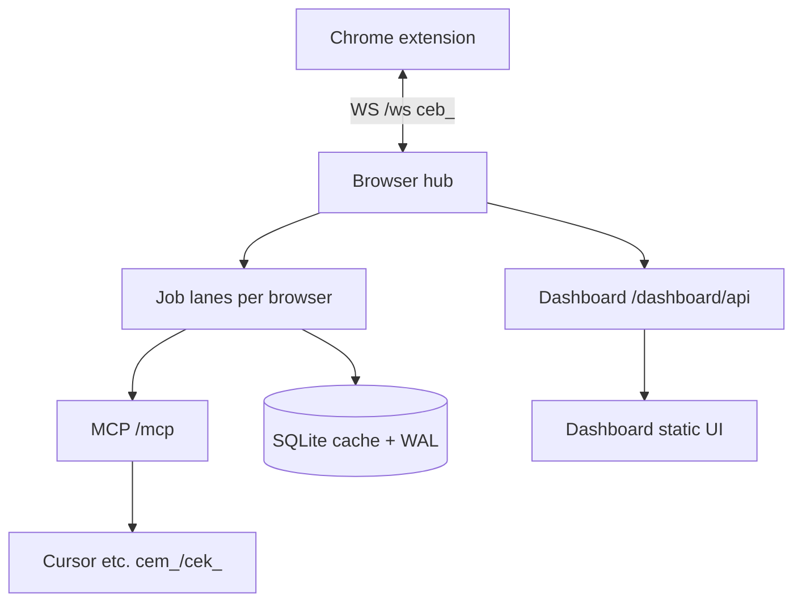

[English](README.md) | [Русский](README.ru.md) · [](https://www.donationalerts.com/r/svwergio_mel)

# chat-export-server

**Local MCP server** for the [Chat Export](https://github.com/svergio/chat-export-extension) Chrome extension. List, read, export, create, delete, and **ask** in your own chats on ChatGPT, Grok, X Grok, Claude, and GitHub Copilot — through the extension in **your** browser. Everything stays on `127.0.0.1`: job queues, SQLite chat cache, audit log, optional [dashboard](https://github.com/svergio/chat-export-dashboard) UI.

## The problem

IDE agents need **structured access** to web LLM sessions without pasting cookies or paying per-token cloud APIs. You want MCP tools, retries, and queues — but data must not leave your machine.

## What you get

| Platform | Automation |
|----------|------------|
| ChatGPT | list / get / export / create / delete / ask |
| Grok (`grok.com`) | same |
| X Grok | same |
| Claude | same |
| GitHub Copilot web | same |



## Quick start (3 steps)

1. **Extension** — load [chat-export-extension](https://github.com/svergio/chat-export-extension) unpacked; enable bridge in popup; open provider tabs logged in.
2. **Server** — `npm install && npm run build`, `chat-export-server key new`, `chat-export-server start` → `http://127.0.0.1:8765`.
3. **MCP client** — point to `http://127.0.0.1:8765/mcp` with `Authorization: Bearer <key>`; run `browsers_bind` then `chats_list` / `chats_export` / `chat_ask`.

Wiki: [MCP tools and profiles](https://github.com/svergio/chat-export-extension/wiki).

## Install and build

```sh
npm install
npm run build   # tsc -> dist/
npm link        # optional: chat-export-server on PATH
```

Requires **Node 22.13+** (`node:sqlite`).

| Script | Purpose |
| --- | --- |
| `npm run build` | compile to `dist/` |
| `npm run typecheck` | `tsc --noEmit` |
| `npm start` | `node dist/cli/index.js start` |
| `npm run dev` | `tsx watch src/cli/index.ts start` |
| `npm run mcp` | stdio MCP attached |

### First run

```sh
chat-export-server key new    # print once; hash stored
chat-export-server start
# WS   /ws, /ext  — extension bridge
# MCP  /mcp       — Bearer key
# GET  /health
```

Data under `~/.chat-export` (override `CHAT_EXPORT_HOME`):

```text
~/.chat-export/
  config.json    # host, port, exportDir
  keys.json      # hashes only (chmod 600)
  audit.log      # MCP/RPC audit
  exports/       # chats_export output
```

```sh
chat-export-server key rotate
chat-export-server key list
chat-export-server status
```

## Background jobs

Long work (`chat_ask`, export, bulk delete) uses per-browser lanes:

- `jobs_enqueue`, `jobs_status`, `jobs_list`, `jobs_cancel`

## Cursor MCP config

HTTP (server already running):

```json
{
  "mcpServers": {
    "chat-export": {
      "url": "http://127.0.0.1:8765/mcp",
      "headers": {
        "Authorization": "Bearer cek_YOUR_KEY_HERE"
      }
    }
  }
}
```

stdio:

```json
{
  "mcpServers": {
    "chat-export": {
      "command": "chat-export-server",
      "args": ["start", "--stdio"],
      "env": {
        "CHAT_EXPORT_HOME": "/Users/YOU/.chat-export"
      }
    }
  }
}
```

## MCP tools (overview)

| Tool | Purpose |
| --- | --- |
| `browsers_list` / `browsers_bind` / `browsers_status` | Connected Chrome profiles |
| `platforms_list` | Enablement matrix |
| `chats_list` / `chats_get` / `chats_export` | Read and write exports |
| `chats_create` / `chats_delete` | UI drive (delete needs `confirm: true`) |
| `chat_ask` | Send prompt; wait or job queue |
| `jobs_*` | Async pipeline |
| `chat_cache_*` | Temp SQLite cache for long threads |

Full list evolves with releases; see wiki **MCP Tools**.

## Layout

```text
packages/protocol/   wire contract v1
src/core/            config, keys, audit, db, jobs, cache
src/hub/             WebSocket BrowserHub
src/mcp/             MCP HTTP + stdio
src/cli/             CLI entry
src/dashboard-api.ts /dashboard/api + dashboard/public
dashboard/           git submodule → chat-export-dashboard
```

`git submodule update --init` after clone.

## Security

- **Loopback only** by default (`127.0.0.1`). Change host only if you understand exposure.
- Keys (`cek_`/`cem_`) grant full local API — never commit or publish.
- Browser tokens (`ceb_`) are separate from MCP keys.
- `chats_delete` and similar need `allowDestructive` on extension **and** server plus `confirm: true`.
- Append-only **audit** for sensitive RPC. See [SECURITY.md](SECURITY.md).
- Personal data portability is the goal; you must comply with each provider **ToS**. Not legal advice.

## Related repositories

| Repo | Role |
|------|------|
| [chat-export-extension](https://github.com/svergio/chat-export-extension) | Content scripts + WS client |
| [chat-export-server](https://github.com/svergio/chat-export-server) (this) | MCP hub, jobs, cache |
| [chat-export-dashboard](https://github.com/svergio/chat-export-dashboard) | Operator UI submodule |
| [Wiki](https://github.com/svergio/chat-export-extension/wiki) | Install, security, FAQ |

## Support the project

- **Tip (fiat):** [DonationAlerts — svwergio_mel](https://www.donationalerts.com/r/svwergio_mel)
- **Crypto (optional):** if maintainers publish receive-only addresses, they appear in project docs — always specify network (e.g. USDT TRC-20). Wrong chain = lost funds. No addresses are required to use the software.

Tips are voluntary; they do not purchase support SLAs or private builds.

## FAQ

- No telemetry; no external servers for core operation.
- Only **your** chats, from **your** browser session.
- Shared wording: [packages/faq.md](packages/faq.md).

## License

See [LICENSE](LICENSE).
