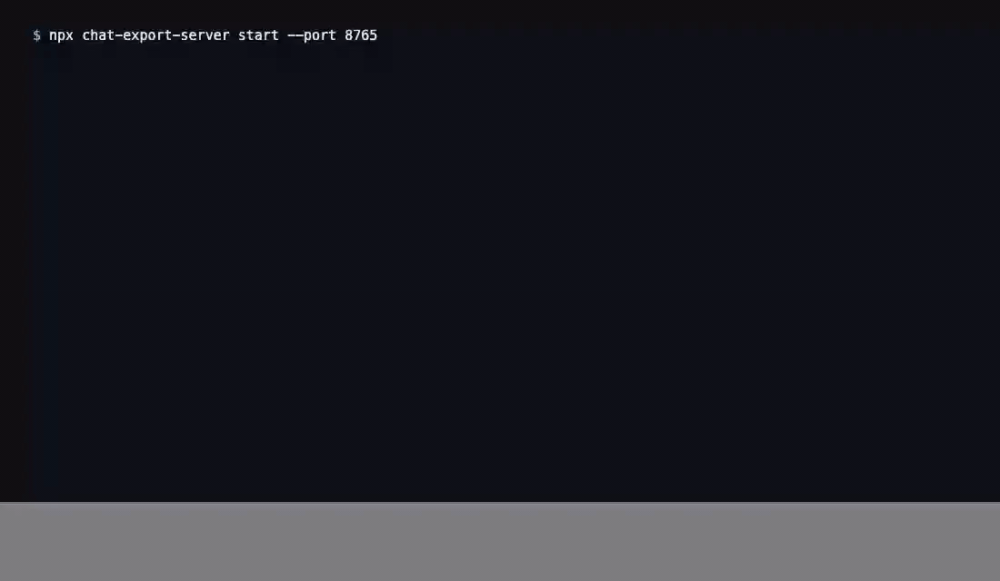

[English](README.md) | [Русский](README.ru.md) · [](https://www.donationalerts.com/r/svwergio_mel) · [](https://glama.ai/mcp/servers/svergio/chat-export-server) · [](https://mcpservers.org/ru/)

# chat-export-server

<p align="center">
  
</p>

**Локальный MCP-сервер** для расширения [Chat Export](https://github.com/svergio/chat-export-extension). Список, чтение, экспорт, создание, удаление и **вопросы** в ваших чатах на **восьми** площадках (ChatGPT, Grok, X Grok, Claude, GitHub Copilot, Qwen, DeepSeek, Perplexity) — через расширение в **вашем** браузере. Всё на `127.0.0.1`: очереди задач, SQLite-кеш, аудит, опциональный [дашборд](https://github.com/svergio/chat-export-dashboard).

В каталоге [Glama](https://glama.ai/mcp/servers/svergio/chat-export-server) (v1.0.4, TDQS 4.4/5).

## Автономный продукт

`chat-export-server` вместе с [расширением Chrome](https://github.com/svergio/chat-export-extension) — полный локальный стек. Операции с чатами в браузере идут через WebSocket-мост расширения — **без** Chrome DevTools MCP, Playwright и без встроенного кода агентов. Деплой **нативно**, **Docker / Colima** или **Kubernetes** (`deploy/k8s`). Любой MCP-клиент (Cursor, Claude Desktop, Open WebUI, локальные LLM вроде Bonsai-27B) — **опционален**.

## Проблема

Агентам в IDE нужен **структурный доступ** к веб-сессиям LLM без утечки cookies и без облачных API. Нужны MCP, очереди и повторы — при этом данные не покидают ваш ПК.

## Платформы

| Платформа | Автоматизация |
|-----------|----------------|
| ChatGPT | list / get / export / create / delete / ask |
| Grok | то же |
| X Grok | то же |
| Claude | то же |
| GitHub Copilot (web) | то же |
| Qwen | то же |
| DeepSeek | то же |
| Perplexity | то же |

## Архитектура

`chat-export-server` слушает loopback (по умолчанию), принимает **browser hub** от расширения по WebSocket (`/ws`, токены `ceb_`), отдаёт **MCP** по HTTP на `/mcp` для IDE (`cem_`/`cek_`), ведёт **очереди задач по браузерам** с SQLite-кешем и WAL и при необходимости раздаёт встроенный **дашборд** на `/dashboard/` и `/dashboard/api`. Длительные операции (`chat_ask`, пакетный экспорт, удаление с ограничениями) идут через очередь, а не блокируют MCP.

Деплой: **нативный** CLI на Node 22, **Docker / Colima** (Compose на `127.0.0.1:8765`) или **Kubernetes** (`kubectl apply -k deploy/k8s`, port-forward для моста Chrome). **Диаграммы Mermaid** и карта эндпоинтов: **[Вики — Архитектура](https://github.com/svergio/chat-export-extension/wiki/Architecture-RU)**. См. также [Нативный деплой, Docker и Kubernetes](https://github.com/svergio/chat-export-extension/wiki/Native-and-Kubernetes-Deployment-RU) · [Сценарии использования](https://github.com/svergio/chat-export-extension/wiki/Use-Cases-RU) · [MCP: инструменты и профили](https://github.com/svergio/chat-export-extension/wiki/MCP-Tools-and-Profiles-RU).

## Быстрый старт (3 шага)

1. **Расширение** — [chat-export-extension](https://github.com/svergio/chat-export-extension), мост в popup, залогиненные вкладки.
2. **Сервер** — `npm install && npm run build`, `chat-export-server key new`, `chat-export-server start`.
3. **MCP** — URL `http://127.0.0.1:8765/mcp`, Bearer-ключ, `browsers_bind`, затем инструменты чатов.

## Установка

```sh
npm install
npm run build
```

Нужен **Node 22.13+**.

```sh
chat-export-server key new
chat-export-server start
```

Данные: `~/.chat-export` (`CHAT_EXPORT_HOME` для переопределения).

## Настройка

### Переменные окружения

Скопируйте [`.env.example`](.env.example) в `.env`. Переменные окружения перекрывают `config.json`, где указано ниже.

| Переменная | Назначение |
|------------|------------|
| `CHAT_EXPORT_HOME` | Каталог данных (`~/.chat-export`; в Docker — `/data`) |
| `CHAT_EXPORT_HOST` | Адрес bind (`127.0.0.1` локально; в контейнере — `0.0.0.0`) |
| `CHAT_EXPORT_PORT` | Порт HTTP (по умолчанию `8765`) |
| `CHAT_EXPORT_ALLOWED_HOSTS` | Доп. имена заголовка `Host` (через запятую) |
| `CHAT_EXPORT_DASHBOARD_ENABLED` | `true` / `false` |
| `CHAT_EXPORT_ADMIN_USER` / `CHAT_EXPORT_ADMIN_PASS` | Логин дашборда |
| `CHAT_EXPORT_MCP_TOKEN` | Опциональный `cem_…` при старте |
| `CHAT_EXPORT_BROWSER_TOKENS` | Авто-энролл `browserId:ceb_…[:label]` |
| `CHAT_EXPORT_ALLOW_DESTRUCTIVE` | `true` / `false` |
| `CHAT_EXPORT_DB_DRIVER` | Драйвер БД |
| `CHAT_EXPORT_DB_URL` | URL БД |
| `CHAT_EXPORT_SKIP_MCP_CONFIG` | `1` — не писать Cursor MCP при `key new` |

### Docker и Colima

В репозитории есть [`Dockerfile`](Dockerfile) (Node 22 Alpine, непривилегированный пользователь, том `/data`, `HEALTHCHECK` на `/health`). **Docker Desktop не нужен** — на macOS используйте [Colima](https://github.com/abiosoft/colima):

```sh
colima start
docker context use colima
cp .env.example .env    # задайте CHAT_EXPORT_ADMIN_PASS
docker --context colima compose build
docker --context colima compose up -d
curl -sS http://127.0.0.1:8765/health
```

Порт только **`127.0.0.1:8765`**. Данные — volume `chat-export-data`.

После проверки остановите контейнер, чтобы локальный демон снова мог слушать `:8765`:

```sh
docker --context colima compose down
```

Раздельный фронт nginx (статика дашборда + прокси API/MCP/WS): см. [chat-export-dashboard](https://github.com/svergio/chat-export-dashboard) и `docker-compose.yml` в дереве сопровождения Chat Export.

### Kubernetes

Манифесты в [`deploy/k8s/`](deploy/k8s/) (non-root UID `10001`, PVC `/data`, пробы `/health`, Ingress с WebSocket для `/ws`, `/ext`, `/mcp`). Деплой: `kubectl apply -k deploy/k8s`; для моста Chrome с хоста — `kubectl port-forward` на `127.0.0.1`. Подробнее: [deploy/k8s/README.md](deploy/k8s/README.md), вики [Native and Kubernetes deployment (RU)](https://github.com/svergio/chat-export-extension/wiki/Native-and-Kubernetes-Deployment-RU).

### `config.json`

Пример (пароли смените на свои):

```json
{
  "host": "127.0.0.1",
  "port": 8765,
  "exportDir": "~/.chat-export/exports",
  "rpcTimeoutMs": 60000,
  "dashboard": {
    "enabled": true,
    "username": "admin",
    "password": "changeme"
  },
  "settings": {
    "platformsEnabled": ["chatgpt", "grok", "grok-x", "copilot", "claude"],
    "allowDestructive": false
  }
}
```

Сервер по умолчанию: **`127.0.0.1:8765`** (`/health`, `/mcp`, `/ws`, `/dashboard/`).

### Токены

| Префикс | Кто использует |
|---------|----------------|
| `cek_` / `cem_` | MCP и CLI (`Authorization: Bearer …`) |
| `ceb_` | Расширение Chrome, WebSocket `/ws` |

Хеши MCP-ключей в `keys.json`; plaintext — один раз при `key new`.

Демон в дереве сопровождения: `tmp-scripts/ensure-daemon.mjs` (порт `8765`, опция `--sync-mcp-json` для `.cursor/mcp.json`).

Расширение: [README extension — Настройка](https://github.com/svergio/chat-export-extension#%D0%BD%D0%B0%D1%81%D1%82%D1%80%D0%BE%D0%B9%D0%BA%D0%B0).

## MCP в Cursor (HTTP)

```json
{
  "mcpServers": {
    "chat-export": {
      "url": "http://127.0.0.1:8765/mcp",
      "headers": {
        "Authorization": "Bearer cek_YOUR_KEY_HERE"
      }
    }
  }
}
```

## Инструменты MCP (кратко)

`browsers_*`, `platforms_list`, `chats_*`, `chat_ask`, `jobs_*`, `chat_cache_*` — см. [вики](https://github.com/svergio/chat-export-extension/wiki).

## Опционально: локальная LLM (например Bonsai-27B)

Любой **внешний** MCP-клиент (Cursor, Claude Desktop, Open WebUI или свой агент) может вызывать Streamable HTTP на `http://127.0.0.1:8765/mcp`. Локальный OpenAI-совместимый рантайм вроде **Bonsai-27B** (oMLX и т.п. на `:8000/v1`) — **опциональный** оркестратор; Chat Export **не** поставляет и не встраивает код агентов. Пример: локальная модель планирует шаги, этот сервер выполняет `chat_ask` / `jobs_*` во вкладках Chrome под вашей сессией. Руководство: вики [Local LLM + Bonsai-27B](https://github.com/svergio/chat-export-extension/wiki/Local-LLM-Bonsai-27B-Guide-RU) ([EN](https://github.com/svergio/chat-export-extension/wiki/Local-LLM-Bonsai-27B-Guide)).

## Безопасность

- По умолчанию только **127.0.0.1**.
- Ключи `cek_`/`cem_` и `ceb_` — раздельно; не публикуйте.
- Удаление — с `allowDestructive` и `confirm: true`.
- [SECURITY.md](SECURITY.md). Соблюдайте **ToS** провайдеров.

## Репозитории

| Репозиторий | Роль |
|-------------|------|
| [extension](https://github.com/svergio/chat-export-extension) | UI и мост |
| [server](https://github.com/svergio/chat-export-server) (этот) | MCP и очереди |
| [dashboard](https://github.com/svergio/chat-export-dashboard) | UI оператора |
| [Wiki](https://github.com/svergio/chat-export-extension/wiki) | Документация |

## Поддержка проекта

- **DonationAlerts:** [svwergio_mel](https://www.donationalerts.com/r/svwergio_mel)

Донаты добровольны.

## Участие в разработке

[CONTRIBUTING.md](./CONTRIBUTING.md) (сборка, `deploy/k8s`, синхронизация dashboard, ветка `test`), [extension CONTRIBUTING](https://github.com/svergio/chat-export-extension/blob/main/CONTRIBUTING.md) (протокол), [вики](https://github.com/svergio/chat-export-extension/wiki/Contributing-RU).

## Зависимости

**Runtime:** Node 22.13+, `@modelcontextprotocol/sdk`, `ws`, `zod`, workspace `@chat-export/protocol` (ISC, `packages/protocol/`). В production нет Playwright, Puppeteer, Electron и облачных SDK.

**Связка продуктов:** [chat-export-extension](https://github.com/svergio/chat-export-extension) (WebSocket `ceb_`) ↔ этот сервер ↔ [chat-export-dashboard](https://github.com/svergio/chat-export-dashboard) (субмодуль `dashboard/`).

Docker: **node:22-alpine**; опционально фронт dashboard на **nginx:alpine**. `package-lock.json` в репозитории — для Dependabot и графа зависимостей GitHub.

Сторонние пакеты: [THIRD_PARTY_NOTICES.md](./THIRD_PARTY_NOTICES.md) (`npm run licenses`). SBOM по желанию: `npm sbom --omit dev`.

**Не обязательны:** Cursor, Open WebUI, BibLLMsteak, Bonsai-27B, пути NodeRed — только MCP-клиенты или документация сопровождения.

## Лицензия

[LICENSE](LICENSE).
